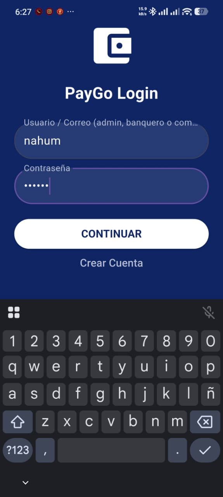
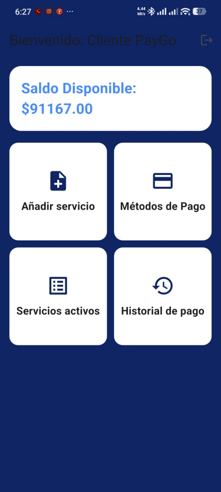
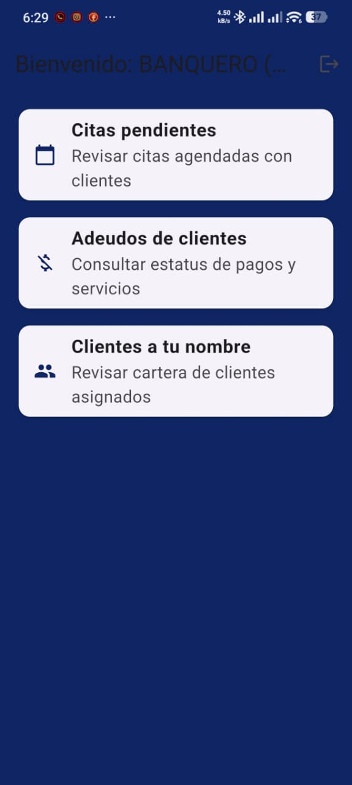
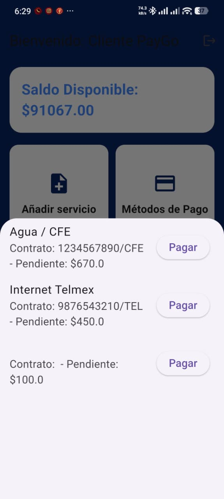
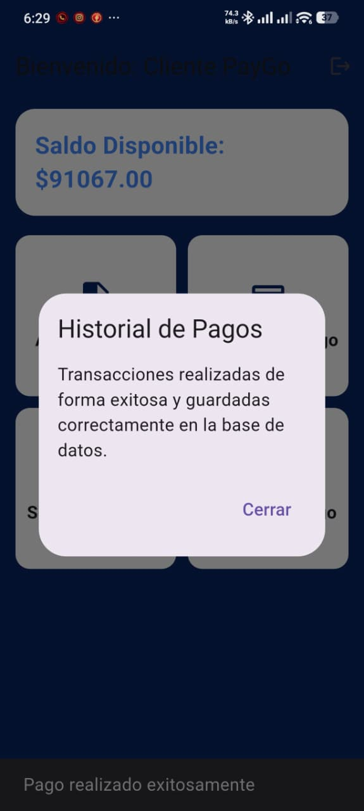
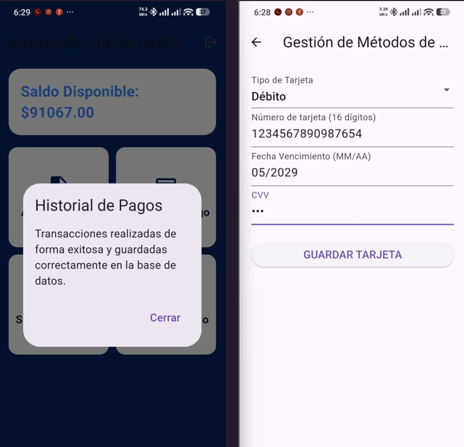

PayGo Mobile

Camarillo Solano Ángel Nahúm
González Rendón Ricardo 
# 1. Descripción Breve

PayGo es una aplicación móvil desarrollada en Flutter para la gestión eficiente de pagos cotidianos y servicios financieros. La plataforma permite a los usuarios monitorear saldos en tiempo real, registrar y pagar servicios activos (como agua, electricidad e internet), administrar métodos de pago, agendar citas de atención y acceder a paneles de control adaptados según el rol del usuario.

# 2. Los 3 Tipos de Usuario y sus Dashboards

La aplicación integra tres perfiles de usuario con permisos e interfaces diferenciadas:

Cliente (Usuario Común):

Acceso al saldo disponible ($91,167.00 MXN).

Opciones rápidas de transferencia, métodos de pago, recargas y ayuda.

Consulta e interacción con la lista de servicios activos e historial de transacciones.

Administrador (RolUsuario.ADMIN):

Panel de control centralizado (AdminDashboard).

Gestión de páginas, reportes generales y administración del sistema.

Banquero / Empleado (RolUsuario.BANQUERO):

Panel de atención operativa (BanqueroDashboard / Worker Mode).

Revisión de citas agendadas, estatus de adeudos y cartera de clientes asignados.

# 3. Manejo de Estado Elegido (y por qué)

Se utilizó la librería Provider (package:provider/provider.dart) como la solución central para el manejo de estado reactivo y global por las siguientes razones:

Rendimiento y Simplicidad: Permite refrescar únicamente los widgets necesarios al modificar saldos, agregar tarjetas o actualizar listas usando notifyListeners().

Recomendación Oficial: Es uno de los enfoques estándar promovidos por la documentación oficial de Flutter.

Persistencia en Sesión: Mantiene los datos del usuario logueado (usuarioActual), sus listas asociadas y su saldo activo a lo largo de todo el flujo de navegación entre pantallas sin perder el contexto.

# 4. Cómo Ejecutar la Aplicación

Requisitos Previos

Flutter SDK (versión igual o superior a 3.0.0)

Android Studio / VS Code con extensión de Flutter

Dispositivo móvil Android/iOS o un emulador activo

Pasos de Instalación

Clonar el repositorio:

git clone https://github.com/Nahum-758/pay_go.git

Entrar al directorio del proyecto:

cd pay_go

Instalar las dependencias requeridas:

flutter pub get

Ejecutar la aplicación:

flutter run

# 5. Demostración al Docente

Dispositivo físico / Emulador usado: POCO X7 Pro (Android 14)

Fecha y modalidad de la demostración: Presencial / Demostración en vivo

# 6. Screenshots

### Splashscreen

### Autenticación

### Dashboards

### Listas

### Formularios

### Evidencia Funcional

